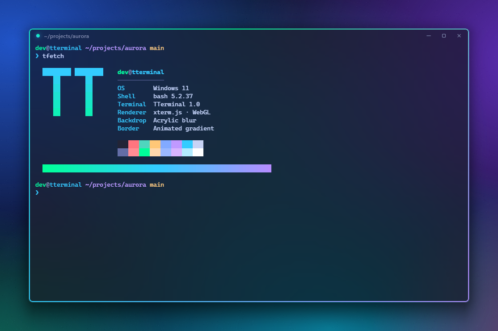
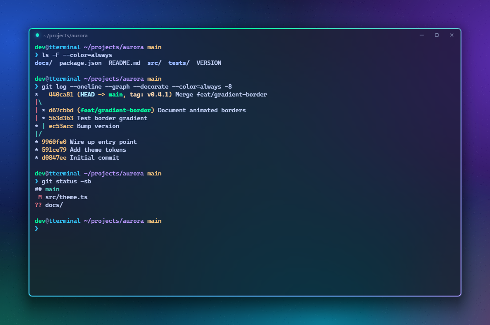
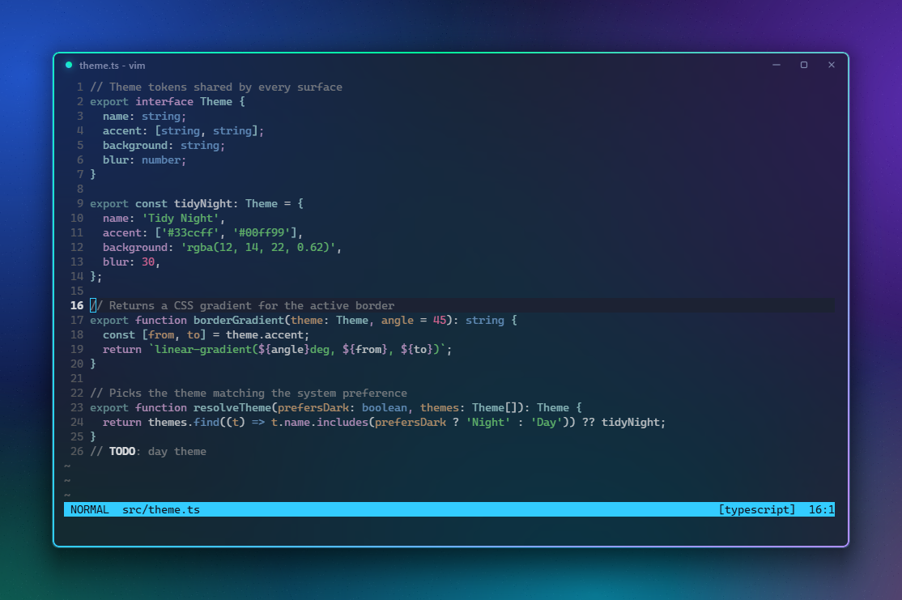
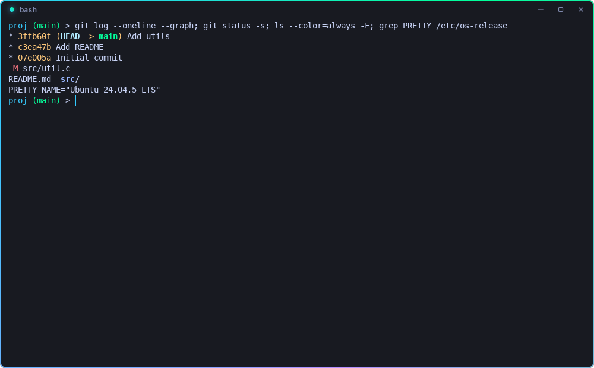

<div align="center">

# TTerminal

**Tidy Terminal** — a lightweight, Hyprland-inspired bash terminal for Windows 11 and Linux.

A single small executable that runs a real bash session inside a frosted-glass window with an animated gradient border: about 2 MB on Windows, about 250 KB on Linux.



</div>

## Features

- **Runs on Windows and Linux.** The same interface on Windows 11 and Ubuntu, with a native host for each.
- **Real bash.** On Windows, Git Bash runs through the Windows pseudo-console (ConPTY), the same layer Windows Terminal uses. On Linux, bash runs on a standard pseudo-terminal. Colors, prompts, `vim`, `less`, `git` and other full-screen programs work as expected.
- **Hyprland-style window.** Acrylic blur, rounded corners, an animated cyan → green → violet border that dims when the window loses focus, and a pop-in open animation.
- **Single, small executable.** About 2 MB on Windows and about 250 KB on Linux, with the web assets embedded. No installer needed.
- **Fast startup.** The prompt is ready in about 0.6 s; bash starts in parallel with the window.
- **Native window behavior.** Snap layouts, Win+Arrow, edge resizing and double-click-to-maximize. On Linux, drag, resize, maximize and the primary selection work too.
- **Light on resources.** The animated border redraws only its own edge pixels and pauses when the window is unfocused. On Linux, output is paced to rendering speed, so memory stays flat even under floods of output.
- **GPU rendering.** xterm.js with the WebGL renderer, 10,000 lines of scrollback, clickable links and truecolor.

| Git workflow | Full-screen apps |
|---|---|
|  |  |

<div align="center">

**On Ubuntu**



</div>

## Download

Get the latest version from the [releases page](https://github.com/Chamesss/TTerminal/releases/latest):

| Platform | File |
|---|---|
| Windows 11 (x64) | `TTerminal.exe` |
| Ubuntu / Debian (x64) | `tterminal_<version>_amd64.deb` |
| Ubuntu / Debian (ARM64) | `tterminal_<version>_arm64.deb` |
| Other Linux distros | `tterminal-<version>-linux-<arch>.tar.gz` |

## Requirements

### Windows

- Windows 11
- [Git for Windows](https://git-scm.com/download/win) (provides `bash.exe`)
- [.NET 9 Desktop Runtime](https://dotnet.microsoft.com/download/dotnet/9.0)
- Microsoft Edge WebView2 Runtime (preinstalled on Windows 11)

### Linux

- Ubuntu 22.04 or newer (or another distro with GTK 3 and WebKitGTK 2.40+)
- `bash`, `libgtk-3-0` and `libwebkit2gtk-4.1-0`. The `.deb` installs these for you.

## Install

### Windows

1. Download `TTerminal.exe` from the [latest release](https://github.com/Chamesss/TTerminal/releases/latest).
2. Put it anywhere and run it.

To find it from Windows search, add a shortcut to the Start Menu folder (`Win+R` → `shell:programs`).

### Ubuntu / Debian

Download `tterminal_<version>_amd64.deb` (or `_arm64.deb`) from the [latest release](https://github.com/Chamesss/TTerminal/releases/latest) and install it:

```
sudo apt install ./tterminal_*_amd64.deb
```

TTerminal then appears in the app launcher. A `.tar.gz` with the bare binary is also attached to each release.

## Usage

```
TTerminal.exe [folder]      # Windows
tterminal [folder]          # Linux
```

Opens bash in `folder`, or in your home directory if none is given.

| Shortcut | Action |
|---|---|
| `Ctrl+C` (with selection) / `Ctrl+Shift+C` | Copy |
| `Ctrl+V` / `Ctrl+Shift+V` | Paste |
| Right-click | Copy selection, or paste |
| `Ctrl` + `+` / `-` / `0`, `Ctrl` + wheel | Font size |
| `Ctrl+Shift+N` | New window in the same folder |
| Select / middle-click | Copy to and paste from the primary selection (Linux) |

### Choosing a shell

TTerminal looks for bash in this order:

| Windows | Linux |
|---|---|
| 1. `TTERMINAL_SHELL` environment variable | 1. `TTERMINAL_SHELL` environment variable |
| 2. `C:\Program Files\Git\bin\bash.exe` (and other Git for Windows locations) | 2. `bash` on `PATH` |
| 3. `C:\msys64\usr\bin\bash.exe` | 3. `$SHELL` |
| 4. `bash.exe` on `PATH` | 4. `/bin/sh` |

### Linux notes

- The frosted blur needs the compositor's help. GNOME shows a dark translucent window. On Hyprland or KDE you can add a blur rule for the `tterminal` window class. Without a compositor the window is opaque with square corners.
- On machines without a GPU (VMs, remote desktops), `TTERMINAL_NO_GPU=1 tterminal` switches to plain CPU painting, which is faster there than software OpenGL.

## Build from source

### Windows

Requires the [.NET 9 SDK](https://dotnet.microsoft.com/download/dotnet/9.0).

```
git clone https://github.com/Chamesss/TTerminal.git
cd TTerminal
dotnet publish -c Release -o dist
```

The executable is written to `dist/TTerminal.exe`.

### Linux

```
sudo apt install build-essential libgtk-3-dev libwebkit2gtk-4.1-dev
git clone https://github.com/Chamesss/TTerminal.git
cd TTerminal/linux
make
sudo make install        # optional: installs to /usr/local with a launcher entry
```

The executable is written to `linux/build/tterminal`. `make deb` and `make tar` build the release packages.

### Releases

Pushing a tag such as `v1.1.0` runs `.github/workflows/release.yml`, which builds `TTerminal.exe` and the Linux `.deb` and `.tar.gz` files for x64 and arm64, then publishes them as a GitHub release.

## How it works

| Part | Windows | Linux |
|---|---|---|
| Frameless window, native move/resize | `MainForm.cs`, `Native.cs` (WinForms, acrylic) | `linux/tterminal.c` (GTK 3) |
| Web view | WebView2 | WebKitGTK |
| Pseudo-terminal running bash | `PseudoConsole.cs` (ConPTY) | `linux/tterminal.c` (`forkpty`) |
| Shell discovery | `Shell.cs` | `linux/tterminal.c` |
| Terminal UI (xterm.js), keybinds, chrome | `web/` (shared) | `web/` (shared) |

The `web/` folder is embedded in the executable and served to the web view from memory, so each release is a single file. On Linux, output is paced to how fast xterm.js parses it: the host sends one batch at a time and stops reading the pty when the page falls behind. Memory therefore stays flat even when a program floods the terminal.

## License

[MIT](LICENSE). Bundled third-party components are listed in [THIRD_PARTY_NOTICES.md](THIRD_PARTY_NOTICES.md).
