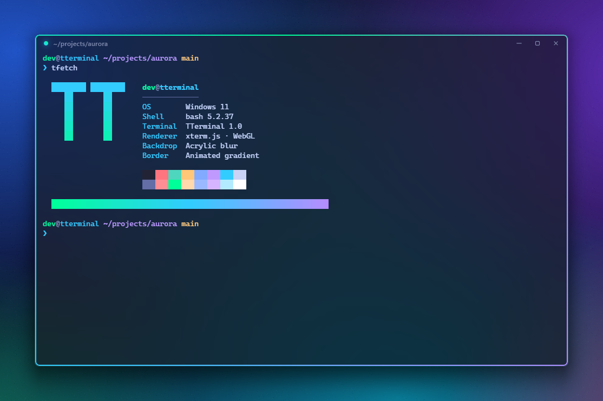
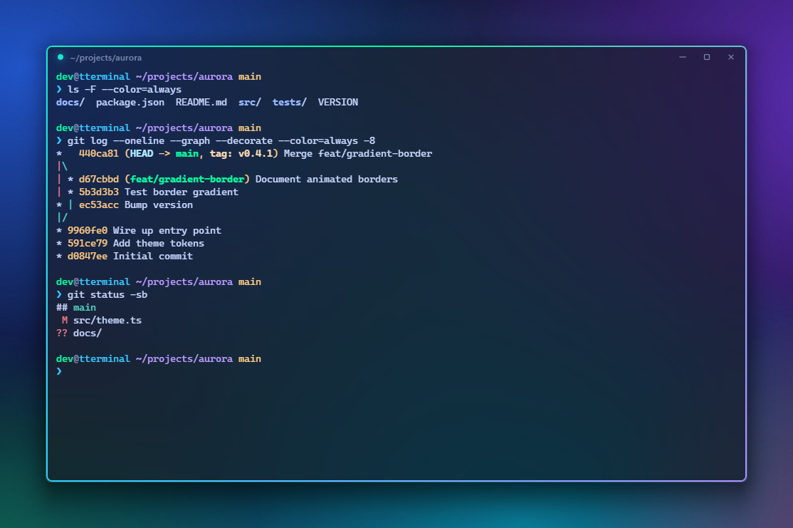
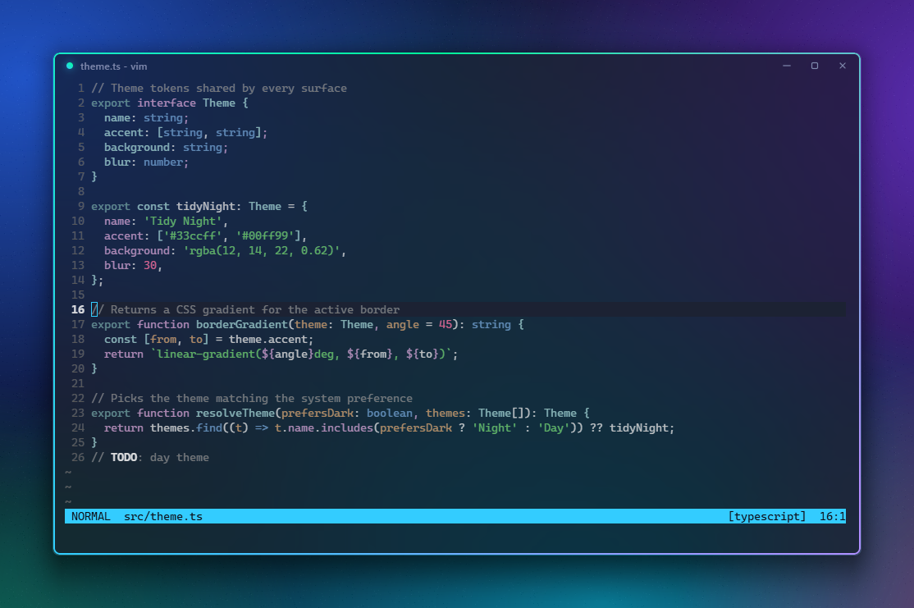

<div align="center">

# TTerminal

**Tidy Terminal** — a lightweight, Hyprland-inspired bash terminal for Windows 11.

A single ~2 MB `.exe` that runs a real Git Bash session inside a frosted-glass window with an animated gradient border.



</div>

## Features

- **Real bash.** Git Bash runs through the Windows pseudo-console (ConPTY), the same layer Windows Terminal uses. Colors, prompts, `vim`, `less`, `git` and other full-screen programs work as expected.
- **Hyprland-style window.** Acrylic blur, rounded corners, an animated cyan → green → violet border that dims when the window loses focus, and a pop-in open animation.
- **Single, small executable.** About 2 MB with the web assets embedded. No installer.
- **Fast startup.** The prompt is ready in about 0.6 s; bash starts in parallel with the window.
- **Native window behavior.** Snap layouts, Win+Arrow, edge resizing and double-click-to-maximize.
- **GPU rendering.** xterm.js with the WebGL renderer, 10,000 lines of scrollback, clickable links and truecolor.

| Git workflow | Full-screen apps |
|---|---|
|  |  |

## Requirements

- Windows 11
- [Git for Windows](https://git-scm.com/download/win) (provides `bash.exe`)
- [.NET 9 Desktop Runtime](https://dotnet.microsoft.com/download/dotnet/9.0)
- Microsoft Edge WebView2 Runtime (preinstalled on Windows 11)

## Install

1. Download `TTerminal.exe` from the [latest release](https://github.com/Chamesss/TTerminal/releases/latest).
2. Put it anywhere and run it.

To find it from Windows search, add a shortcut to the Start Menu folder (`Win+R` → `shell:programs`).

## Usage

```
TTerminal.exe [folder]
```

Opens bash in `folder`, or in your home directory if none is given.

| Shortcut | Action |
|---|---|
| `Ctrl+C` (with selection) / `Ctrl+Shift+C` | Copy |
| `Ctrl+V` / `Ctrl+Shift+V` | Paste |
| Right-click | Copy selection, or paste |
| `Ctrl` + `+` / `-` / `0`, `Ctrl` + wheel | Font size |
| `Ctrl+Shift+N` | New window in the same folder |

### Choosing a shell

TTerminal looks for bash in this order:

1. `TTERMINAL_SHELL` environment variable
2. `C:\Program Files\Git\bin\bash.exe` (and other Git for Windows locations)
3. `C:\msys64\usr\bin\bash.exe`
4. `bash.exe` on `PATH`

## Build from source

Requires the [.NET 9 SDK](https://dotnet.microsoft.com/download/dotnet/9.0).

```
git clone https://github.com/Chamesss/TTerminal.git
cd TTerminal
dotnet publish -c Release -o dist
```

The executable is written to `dist/TTerminal.exe`.

## How it works

| Part | File |
|---|---|
| Frameless window, acrylic backdrop, native resize | `MainForm.cs`, `Native.cs` |
| ConPTY session running bash | `PseudoConsole.cs` |
| Shell discovery | `Shell.cs` |
| Terminal UI (xterm.js), keybinds, chrome | `web/app.js`, `web/style.css`, `web/index.html` |

The `web/` folder is embedded in the executable and served to WebView2 from memory, so the release is a single file.

## License

[MIT](LICENSE). Bundled third-party components are listed in [THIRD_PARTY_NOTICES.md](THIRD_PARTY_NOTICES.md).
